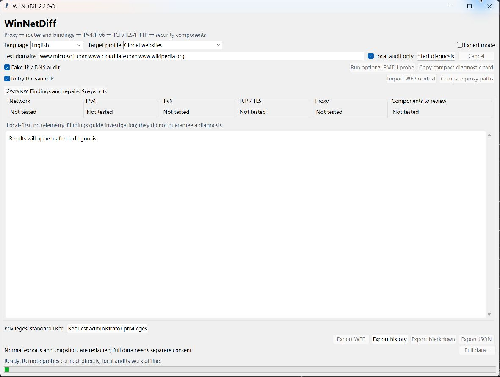

# WinNetDiff

Final GUI repairs are included: normal exports redact directly; **Full data…** requires fresh acknowledgement and explicit export. Enter/Escape/window close cancel full export. Missing save folders require deliberate selection, and cancelled/failed/incomplete scans are labelled. [Current acceptance and limits](docs/gui-final-2.2.0a3.md).

**Source Alpha review candidate (not published).** Formal Windows EXE/Release remains blocked pending controlled proxy write/restore and clean Windows 11 VM testing. The interactive repair path is not validated for production use. [Current 2.2.0a3 evidence](docs/gui-final-2.2.0a3.md) · [Source-publication checklist](docs/source-alpha-publication.md) · [Validation](docs/validation.md).




Actual 2.2.0a3 Windows startup, English UI, captured during this Source Alpha review. The app uses an isolated profile; no scan results, device identifiers or personal paths are shown.

**Find the broken layer, not just the broken connection.**

WinNetDiff is an open-source, privacy-first Windows network differential diagnostics and repair toolkit by **Alden**. It compares proxy, route, IPv4/IPv6, DNS/TCP/TLS/HTTP, and network-filter evidence to narrow an investigation. It is a diagnostic aid and does not guarantee that it can identify or repair every Windows networking fault.

[简体中文](README.zh-CN.md) · [繁體中文](README.zh-TW.md) · [Privacy](PRIVACY.md) · [Safety](docs/safety-model.md)

Version **2.2.0a3** is a preview prepared for review. A local build or a green CI job is not proof that every Windows repair has been tested. See [validation levels](docs/validation.md) and [release notes](docs/release-notes.md). No GitHub repository or release is created automatically by this source tree.

## What it does

- Measures TCP connect, verified TLS handshake, and HTTP response on the **same IP and TCP connection**, with individual timings, bounded retries, and all attempts retained.
- Audits active proxies and loopback listeners, routes and effective metrics, NDIS bindings, Windows services/drivers, security-provider registrations, installed applications, and available file signatures.
- Grades orphan-component evidence without treating a vendor name or third-party binding as proof of a fault.
- Saves versioned network snapshots and compares added, removed, enabled, disabled, and changed entries.
- Shows evidence, alternative explanations, falsifiable next checks, and repair risk. After a confirmed reversible repair, it rechecks the same targets and reports whether improvement was verified.
- Offers English, Simplified Chinese, and Traditional Chinese. Language suggests a target profile; users can select another profile or enter custom domains.

The interface has a basic view for the likely issue and next step, and an expert view for stage records, routes, bindings, services, and raw evidence. Screenshots, when included in `docs/images/`, must show the actual application with synthetic or reviewed data; there are no concept mockups presented as implemented UI.

## Run on Windows

Source requirements: Windows 10/11, Python **3.10+**, and Tcl/Tk for the GUI. The application uses only the Python standard library. Windows 11 x64 is the main validation target. Developer packaging tools are not application runtime dependencies.

```powershell
# GUI, with a language and its suggested target profile
py -3 windows_net_diffdiag.py --lang en
py -3 windows_net_diffdiag.py --lang zh-CN
py -3 windows_net_diffdiag.py --lang zh-TW

# Equivalent modular source entry point
py -3 -m winnetdiff --lang en

# Read-only local audit; no remote diagnostic probes
py -3 windows_net_diffdiag.py --cli --lang en --no-network

# Choose targets independently of language
py -3 windows_net_diffdiag.py --cli --lang en --profile mainland
py -3 windows_net_diffdiag.py --cli --hosts example.com,www.microsoft.com --retries 2
```

`--no-network` still permits loopback proxy-listener checks. Normal scans do not request administrator privileges automatically. Restricted queries stay explicitly incomplete rather than becoming evidence that a configuration is absent.

Once a maintainer publishes reviewed assets, users can run `WinNetDiff.exe` for the GUI or `WinNetDiff-CLI.exe` for CLI operations without installing Python. The EXEs are unsigned unless the release explicitly says otherwise; Windows SmartScreen may warn. Verify the source and checksum and make your own trust decision. Do not disable Defender or bypass warnings unconditionally.

## Language and test destinations

The default mappings are English → `global`, 简体中文 → `mainland`, and 繁體中文 → `traditional`. Profiles use multiple configurable targets rather than relying solely on Google or Baidu. A UI-language change must not overwrite custom domains. Public target availability varies by location and time; a failed target is an observation, not a diagnosis of the whole connection. The selector displays the actual domains before a scan starts.

| Suggested language | Profile | Default domains |
|---|---|---|
| English | `global` | `www.microsoft.com`, `www.cloudflare.com`, `www.wikipedia.org` |
| 简体中文 | `mainland` | `www.baidu.com`, `www.qq.com`, `www.bilibili.com` |
| 繁體中文 | `traditional` | `www.microsoft.com`, `www.cloudflare.com`, `www.yahoo.com` |

## Reports and snapshots

```powershell
py -3 windows_net_diffdiag.py --cli --lang en --json report.json --markdown report.md
py -3 windows_net_diffdiag.py --cli --no-network --snapshot baseline.json
py -3 windows_net_diffdiag.py --cli --compare baseline.json after.json
```

Reports and snapshots are redacted by default. Full private reports require `--full-report --confirm-private`; WFP XML is always sensitive and requires explicit confirmation. Review even redacted files before sharing. Never attach the private repair journal or raw WFP XML to a public issue. Snapshot compatibility and field semantics are documented in [snapshot schema](docs/snapshot-schema.md).

Synthetic regression data in `examples/` and `tests/fixtures/` is not a real user's network report. The `orphaned_endpoint_security_filter` scenario demonstrates that repeated TCP success/TLS timeout plus corroborating orphan evidence raises an investigation priority. MTU, servers, and TLS middleboxes remain alternatives; no driver deadlock is claimed.

## Safety boundaries

Scans are read-only. Only explicitly confirmed, eligible user-level proxy changes and restoration are executable repair actions. They require a durable original-state backup, a pre-change reread, post-change verification, and a journal; conflicts prevent overwriting a newer configuration. DNS-cache clearing is manual guidance by default because old cache contents cannot be reliably restored. Binding changes and security-driver removal have no generic one-click execution path. See [safety model](docs/safety-model.md).

## Development and validation

Edit `winnetdiff/`, not the generated standalone file. CLI and GUI use the same core engine. Regenerate and test with:

```powershell
py -3 scripts/build_standalone.py
py -3 scripts/build_standalone.py --check
py -3 -m unittest discover -s tests -v
py -3 windows_net_diffdiag.py --self-test
py -3 scripts/publication_audit.py
powershell.exe -NoProfile -ExecutionPolicy Bypass -File scripts/validate_windows.ps1
```

The local Windows validation script writes private evidence under ignored `.local_validation/`; it does not repair network settings. Read [architecture](docs/architecture.md), [diagnostic methodology](docs/diagnostic-methodology.md), [contribution guidance](CONTRIBUTING.md), and the [roadmap](docs/roadmap.md).

To build unsigned x64 Windows EXEs on Windows, run `scripts/build_exe.ps1`. Use `-OutputDirectory <local-folder>` to select a separate artifact directory without replacing an executable already open. This creates an isolated `.build-venv` and installs pinned build requirements from PyPI unless `-NoInstall` is passed. The build runs tests and publication checks, produces GUI and CLI executables, and writes SHA-256 checksums under ignored `dist/`.

```powershell
Get-FileHash .\WinNetDiff.exe -Algorithm SHA256
```

Compare the digest with `SHA256SUMS.txt` from the same reviewed release. Build provenance, when available, identifies an artifact's build origin; it is not an antivirus verdict or a code-signing certificate.

## License and author

Copyright (c) 2026 **Alden**. Project source is under the [MIT License](LICENSE). No personal legal name or private email is included. A public GitHub profile link will be added only after Alden supplies one. Third-party build and interpreter licensing is described in [licensing provenance](docs/licensing-provenance.md).


## Optional diagnostics (introduced in 2.2.0a2)

- DNS/Fake-IP audit correlates system DNS answers in `198.18.0.0/15` with the most specific usable target route, interface state, configured DNS and known proxy-core process inventory. A healthy TUN mapping is expected behavior. A missing usable route plus matching TCP failure and an absent known core is only a stale-mapping suspicion. Private or loopback DNS alone is never a fault. Offline audits retain configuration context and say what was not tested.
- PMTU is an explicitly consented auxiliary IPv4 DF Echo test after repeated TLS timeouts to the same IP. It records payload and estimated IPv4 packet size. Explicit Fragmentation Needed means feedback arrived; silence or size differences cannot diagnose a PMTUD black hole. No MTU/MSS/registry setting is changed.
- **Copy compact diagnostic card** opens a preview before the separate copy button. The generator uses allowed categories, enums, version and numeric timings; it excludes raw names, addresses, domains, URLs, errors and dynamic Finding prose. The compact card actually checks its final length at **500 characters maximum**. Review it before sharing; it is not a guarantee of anonymity. Nothing is uploaded.

```powershell
py -3 windows_net_diffdiag.py --cli --no-network --share-card
py -3 windows_net_diffdiag.py --cli --no-network --no-fake-ip-audit
# Explicit consent; only eligible repeated same-IP IPv4 TLS failures get ICMP probes
py -3 windows_net_diffdiag.py --cli --pmtu --confirm-pmtu
```

Language, target profile and the optional audit switch remain independent. `--fake-ip-audit` explicitly enables the audit. PMTU never runs automatically in an ordinary scan. CLI report/snapshot/WFP saves refuse existing files; GUI replacement requires confirmation and publishes a complete file atomically.


Current combined-review evidence and limitations: [2.2.0a2 integration](docs/combined-review-2.2.0a2.md).

## 2.2.0a3 F5 / F6 / F7

Generic host association, consented enterprise HTTP proxy-path diagnostics and same-IP retries are now implemented. [Commands, current evidence and limits](docs/f567-2.2.0a3.md). Default retries pin one address; use --retry-mode rotate to sample DNS alternatives. --proxy-paths requires --confirm-proxy-paths and an online CLI scan. WFP input is historical context.
