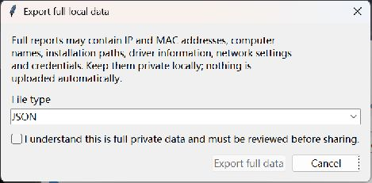

# Final 2.2.0a3 GUI repairs — Source Alpha, unpublished

This revision fixes the three observed GUI defects without adding features. Version remains **2.2.0a3**; formal binary release remains blocked. Earlier 458-case Windows/source-alpha logs belong to the preceding source digest and remain historical.

Current generated source SHA-256: `e4b0dee1dfce0129461f258139248758b10915a4f1178a17c1ecbc11237b3db8`.

| Defect | Before | Current behavior |
|---|---|---|
| GUI-01 privacy | Yes/full was the native confirmation default, so Enter could select full data. | Normal JSON/Markdown/history/snapshot export redacts directly. Separate Full data action requires a fresh unchecked acknowledgement and explicit export button; Enter, Escape, Cancel and window close never accept. Full JSON/Markdown/history/snapshot remain available. |
| GUI-02 location | Missing initial folder could cause native Save As to fall back to the working directory. | Verify the initial folder; if missing, require deliberate selection of an existing folder before Save As. Cancel writes nothing; validate selected parent, ask before overwrite with default No, report failures and retain atomic writes. |
| GUI-03 cancellation | Generic completed status could hide cancellation. | Distinguish Completed, Cancelled, Failed and Partial / Incomplete in all three languages. Retain partial evidence and cancellation flag, wait for the worker to exit before re-enabling controls, refuse overlapping starts and allow restart. |

## Fresh Windows evidence, 2026-10-25

Windows 11 x64 build 26200, Python 3.12.14, PowerShell 5.1. The current full suite passes **476/476 with no skips**, including **18 new targeted contracts**. Existing overwrite fixtures were adjusted to the removed full-data prompt; their rejection/preservation and successful-replacement assertions remain, with explicit call counts. The independent 14-test restore regression is unchanged. Self-tests and final source-package checks are recorded separately in the owner evidence.

The new tests use actual Tk callbacks and event generation for Enter/Escape/close, including an acknowledged dialog with the export button focused. Windows Tk does not consistently synthesize `KP_Enter`; that case additionally checks that an ignored event cannot grant full export, then cancels. Native Return was also exercised through actual Windows input. This limitation is not labelled as native keypad hardware coverage.

GUI regression scope also includes default redacted JSON/Markdown/history/snapshot, intentional full formats, missing-folder selection/cancel, nonexistent chosen parent, explicit overwrite, failed atomic replacement preserving original data, bounded synthetic worker cancellation, no overlapping starts, retained evidence and successful restart. No real collectors, network changes, UAC or security-component mutations run in these tests.

## Actual visual acceptance

The current modular GUI ran with synthetic data and isolated settings. It was visually inspected in English, Simplified Chinese and Traditional Chinese, basic and expert modes. Native Enter, Escape and system window close cancelled the unchecked full-data dialog without opening Save As. Normal JSON opened native Save As directly in the existing isolated output folder; cancellation wrote no file. Scan cancellation displayed an incomplete-evidence warning; a new scan subsequently displayed normal completion. A narrower actual window retained bottom controls.

These native captures/input checks were made during this repair round at source `f51408c3e36cb8eec0fe372920fca6fa662860b91732092eedaa2fac3b7bea27`, before the final change extending the same consent guard to raw WFP. The final WFP path is covered by current real-Tk automated tests; an additional native visual attempt failed with `failed to activate captured window` after one fresh-selection retry. **Final WFP native visual inspection is NOT TESTED.** No earlier screenshot is presented as proof of that final path or of a new EXE. The unchanged normal-export/cancellation UI remains illustrated by the truthful captures below.

The startup screenshot shows the real current application before a scan. The full-data image is its actual unchecked confirmation window, not a mockup:

Actual native visual coverage is **150% / 144 DPI**, under the existing dark OS setting, with the application's light theme and a readable dark native Save As dialog. **Native 100%/200%, OS light mode and a full application dark theme are NOT TESTED.** Automated mapped geometry/scaling tests do not replace those native checks. No OS display/theme or security setting was changed. Owner evidence contains truthful before/after captures; native file-sidebars and unrelated desktop images are excluded.

## Remaining boundaries

Current module/standalone local-only entry points were re-run in three languages. Earlier EXEs have a different source hash; they were not reused as current validation. This round does not build or distribute a new EXE. **Controlled WinINET repair/restore/conflict, UAC and alternate HKCU, elevated WFP, clean no-Python Windows VM, Defender/SmartScreen, signing and remote GitHub CI are NOT TESTED this round.** None is inferred from unit tests or GUI fixtures. Formal Release Gate stays false.

One known fail-closed tooling limit remains: source ZIP acceptance should run outside another Git worktree. When extracted under an ignored parent-repository directory, publication inventory can read the parent's empty file list and reject missing modules. The final package is tested in a standalone directory; no assertion is bypassed.

Source Alpha can proceed to the owner's exact-tree/destination/identity review. No source publication blocker was identified in the completed local scope; untested platform coverage and controlled repair are explicit preview limitations. No remote repository, push, tag, Release or EXE publication is authorized by this document. See [readiness](source-alpha-readiness.md), [publication procedure](source-alpha-publication.md) and [About proposal](github-about.md).
